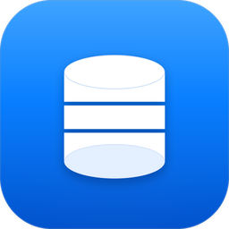

<p align="center">
  
</p>

<h1 align="center">MieoSQL</h1>

<p align="center">
  <strong>A native, multi-engine database client — Rust core, TypeScript UI, one executable per OS.</strong><br/>
  PostgreSQL · MySQL · MariaDB · SQLite · SQL Server · ClickHouse · MongoDB · Redis · Kafka
</p>

<p align="center">
  <a href="https://github.com/vms-mieo/mieosql/actions/workflows/ci.yml"></a>
  <a href="https://github.com/vms-mieo/mieosql/releases"></a>
  
  
</p>

---

MieoSQL is a Navicat-class database client that ships as **one self-contained
executable per OS**. The core is pure Rust — no OpenSSL, no external database
client libraries — and the UI is a React/TypeScript app running in a Tauri 2
webview. It connects to relational databases, document stores, key-value
stores and Kafka brokers from a single three-pane workspace.

> **Project status:** early development (0.1.x). The core feature set is
> implemented and used daily; interfaces may still change before 1.0.

## Features

### Engines

- **Pure-Rust drivers** for PostgreSQL, MySQL, MariaDB, SQLite (bundled),
  SQL Server / Azure SQL, ClickHouse, MongoDB / AWS DocumentDB, Redis, and
  Apache Kafka — no OpenSSL or native client libraries required.
- **Cloud presets** for Aurora, Redshift, Azure SQL, DocumentDB, ElastiCache,
  Memorystore, Confluent, Aiven, and ClickHouse Cloud.
- **Lossless value model**: 64-bit integers and decimals travel as strings
  (no precision loss above 2^53), binary data as base64, timestamps as
  RFC 3339, PostgreSQL arrays preserved.

### Connections & security

- Connection profiles with separated secrets — `profiles.json` never contains
  passwords.
- **Encrypted vault** (XChaCha20-Poly1305) for stored credentials.
- **SSH tunnels** via `russh`: password, private key, or ssh-agent
  authentication, with `known_hosts` host-key verification.
- SSL/TLS modes (prefer / require / verify-CA / verify-full), connection
  testing, per-connection groups and colors.

### SQL editor

- CodeMirror 6 with engine-aware syntax highlighting and completion.
- Schema-aware **autocomplete, hover, rename symbol**, format/minify.
- **Live lint** with gutter markers and one-click fixes.
- Parameterized queries, multi-statement scripts, per-session transactions
  (begin / commit / rollback), query cancellation.

### Data grid

- Virtualized grid that stays smooth at 100k+ rows.
- **Inline editing** with diff-based `UPDATE`/`DELETE` and insert drafts.
- Column resize (double-click to auto-fit), per-column sort, client-side
  filter, frozen columns, find-in-grid, full-value viewer (pretty JSON).
- **Table pagination** — page forward/back or jump to the last page with an
  exact `COUNT(*)`.
- Multiple result sets per run with pinning, plus Messages and Status tabs.

### Schema & data tools

- Object browser and inspector: tables, views, materialized views,
  sequences, columns, indexes, foreign keys, DDL.
- **Structure sync** — schema diff between two databases, per-table
  selection, editable migration SQL before applying.
- **Data sync** and **cross-engine data transfer**.
- **ER diagrams** with pan/zoom and SVG/PNG export.
- **Data generation** (21 strategies, reproducible seeds) and **masked
  export** for safe test data.
- **Data dictionary** export (Markdown / HTML), schema snapshots, and
  workspace bundles for sharing connection lists without secrets.
- Backup / restore, index editor, trigger browser.

### Admin & ops

- User and role management with grants (engines that support it).
- Query history (JSONL-backed) and reusable snippets.
- Kafka: topic browser, message viewer, produce messages.

### Export

- CSV, TSV, JSON, JSON Lines, SQL INSERTs, and **Excel (XLSX)**.
- Exports re-run server-side and stream directly to disk — result size is
  not limited by the UI bridge.

## Supported engines

| Engine | Status | Driver |
|---|---|---|
| PostgreSQL | ✅ | `sqlx` |
| MySQL / MariaDB | ✅ | `sqlx` |
| SQLite | ✅ (bundled) | `sqlx` |
| SQL Server / Azure SQL | ✅ | `tiberius` |
| ClickHouse | ✅ | `clickhouse` (HTTP 8123/8443) |
| MongoDB / AWS DocumentDB | ✅ | `mongodb` |
| Redis / ElastiCache / Memorystore | ✅ | `redis` |
| Apache Kafka | ✅ | `rskafka` (SASL PLAIN/SCRAM, TLS) |
| Oracle, Snowflake | 🔜 planned | — |

## Install

### Prebuilt installers

Download the latest packages from
[GitHub Releases](https://github.com/vms-mieo/mieosql/releases):

| Platform | Package |
|---|---|
| macOS (Apple Silicon) | `.dmg` |
| Windows (x64) | NSIS `*-setup.exe` |
| Linux (amd64) | `.deb` · Arch `.pkg.tar.zst` |

### Build from source

**Prerequisites:** Rust 1.97+ (pinned by `rust-toolchain.toml`), Node.js 22+,
and the platform's [Tauri prerequisites](https://v2.tauri.app/start/prerequisites/)
(WebView2 on Windows, `webkit2gtk-4.1` on Linux).

```bash
git clone https://github.com/vms-mieo/mieosql.git
cd mieosql

# 1. Build the frontend (the app binary embeds it — no dev server needed)
cd apps/mieosql-desktop/frontend
npm ci && npm run build
cd ../../..

# 2. Build and run the desktop app
cargo build -p mieosql-desktop --release
./target/release/MieoSQL
```

Run the backend tests (SQLite integration tests need no server):

```bash
cargo test
./scripts/demo-sqlite.sh        # end-to-end CLI demo
```

### Development

```bash
# Frontend hot-reload (Vite on :5173, app pointed at it)
cargo install tauri-cli --version "^2"
cd apps/mieosql-desktop
cargo tauri dev --config tauri.dev.conf.json

# Regenerate the TypeScript bindings after changing Rust DTOs
cargo run -p mieosql-api --bin export-ts -- apps/mieosql-desktop/frontend/src/bindings
```

### Packaging

```bash
cd apps/mieosql-desktop
cargo tauri build        # .dmg / .AppImage / .deb / NSIS .exe
```

Tagged releases (`v*`) are built and published automatically by
[`.github/workflows/release.yml`](.github/workflows/release.yml).

## Architecture

```
┌────────────────────── apps/mieosql-desktop (Tauri 2) ──────────────────────┐
│  React 19 + Vite + Tailwind 4 + CodeMirror 6        (frontend/, TypeScript)│
│        ⇅ invoke() / "mieosql://query" events                               │
│  commands.rs — IPC command surface                                         │
├────────────────────────────────────────────────────────────────────────────┤
│  mieosql-api      DTO + Api facade + TypeScript binding export             │
│  mieosql-engine   sessions · vault · profile store · history · cancellation│
│  mieosql-drivers  AnyDriver: sqlx · tiberius · mongodb · redis · rskafka · │
│                   clickhouse                                               │
│  mieosql-core     value model · schema model · errors · profiles · events  │
└────────────────────────────────────────────────────────────────────────────┘
        apps/mieosql-cli  ← second consumer of the same API
```

| Path | Description |
|---|---|
| `crates/mieosql-core` | Value/schema model, errors, connection profiles, query events (TS derives) |
| `crates/mieosql-drivers` | `AnyDriver` over sqlx, tiberius, mongodb, redis, rskafka, clickhouse |
| `crates/mieosql-engine` | Sessions, vault, profile store, history, cancellation |
| `crates/mieosql-api` | API facade, DTOs, `export-ts` binary |
| `apps/mieosql-cli` | Headless CLI |
| `apps/mieosql-desktop` | Tauri 2 shell + React/TypeScript frontend |
| `docs/` | Operational docs (see [code signing](docs/CODE_SIGNING.md)) |
| `scripts/` | Demo and packaging helpers |

## Security & privacy

- **Local-first**: profiles, history, and the credential vault live in your
  user config directory. Nothing is uploaded anywhere.
- **No telemetry, no CDN** — the UI is fully offline; the only network
  connections are the database servers you configure.
- **Encrypted secrets**: passwords and SSH credentials are stored in a
  XChaCha20-Poly1305 vault, never in plain text.
- **Verified tunnels**: SSH host keys are checked against `known_hosts` by
  default.

## Code signing policy

Free code signing provided by [SignPath.io](https://about.signpath.io), certificate by [SignPath Foundation](https://signpath.org).

- Committers and reviewers: [@vms-mieo](https://github.com/vms-mieo)
- Approvers: [@vms-mieo](https://github.com/vms-mieo)

Privacy policy: This program will not transfer any information to other
networked systems unless specifically requested by the user or the person
installing or operating it. MieoSQL only connects to the database servers you
configure; it collects no telemetry.

Platform signing setup (macOS notarization, Windows Authenticode, SignPath)
is documented in [docs/CODE_SIGNING.md](docs/CODE_SIGNING.md).

## Contributing

Issues and pull requests are welcome. Before opening a PR:

```bash
cargo fmt && cargo clippy --workspace
cargo test
cd apps/mieosql-desktop/frontend && npm run build
```

## License

Licensed under either of [MIT](LICENSE-MIT) or
[Apache License, Version 2.0](LICENSE-APACHE), at your option.
